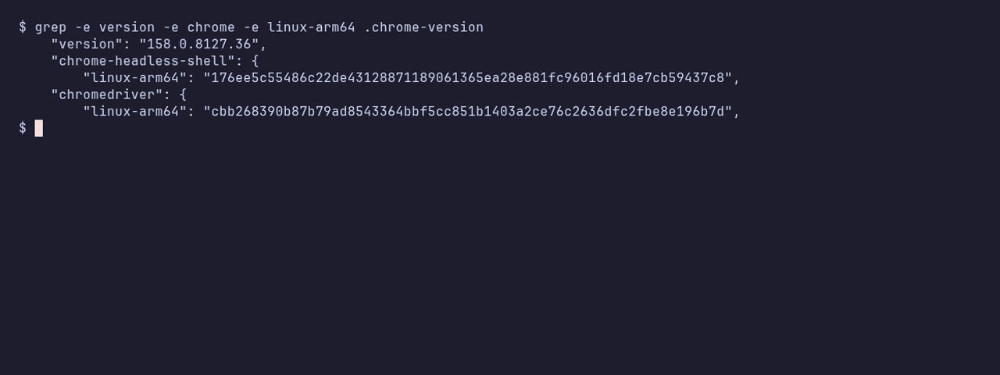

# cdp-browser-installer: pinned Chrome for Testing and ChromeDriver for PHP

**Installs chrome-headless-shell and ChromeDriver of the same version from Chrome for Testing, pinned and SHA-256-checked, for PHP browser tests with Laravel Dusk, Symfony Panther, php-webdriver, chrome-php or Mink on glibc Linux and macOS. No Node.**

[](https://github.com/sorge-it/cdp-browser-installer/actions/workflows/tests.yml)
[](https://github.com/sorge-it/cdp-browser-installer/actions/workflows/chrome-for-testing.yml)
[](https://github.com/sorge-it/cdp-browser-installer/actions/workflows/works-with.yml)
[](https://packagist.org/packages/sorge-it/cdp-browser-installer)
[](https://github.com/sorge-it/cdp-browser-installer/blob/main/LICENSE)
[](https://github.com/sorge-it/cdp-browser-installer/blob/main/composer.json)

The browser and ChromeDriver, which this README calls the pair, come from one [Chrome for Testing](https://googlechromelabs.github.io/chrome-for-testing/)
version, so ChromeDriver does not fail with `session not created: This version of ChromeDriver only supports Chrome version …`.
The package is the PHP counterpart of `npx @puppeteer/browsers install`.



The demo installs the pair from the pin file. Then it removes the pair, keeps the archives as a CI
cache does, and adds one byte to the browser archive: `install` deletes that archive and unpacks
nothing. The demo runs in Docker on Debian 13, linux-arm64; the GIF skips the wait for the download.

## Contents

- [Why this exists](#why-this-exists) · [Installation](#installation) · [Quick start](#quick-start)
- [Works with](#works-with): [Dusk](#laravel-dusk-laraveldusk) · [Panther](#symfony-panther-symfonypanther) · [PantherTestCase](#symfony-panther-with-panthertestcase) ·
  [php-webdriver](#php-webdriverwebdriver) · [chrome-php](#chrome-phpchrome) · [Mink](#mink-dmorechrome-mink-driver)
- [GitHub Actions](#github-actions): [Dusk](#laravel-dusk-on-github-actions)
- [Use from PHP](#use-from-php) · [Run the browser and ChromeDriver](#run-the-browser-and-chromedriver) · [The pin file](#the-pin-file)
- [Security](#security) · [When to use it, and when not to](#when-to-use-it-and-when-not-to) · [Comparison with other packages](#comparison-with-other-packages)
- [Reference](#reference): [Commands](#commands) · [Environment variables](#environment-variables) ·
  [Cache directory](#cache-directory) · [API](#api) · [Exceptions](#exceptions)
- [Troubleshooting](#troubleshooting) · [Compatibility](#compatibility): [Alpine](#alpine-and-other-musl-systems)
- [Development](#development) · [Support](#support) · [License](#license) · [Trademarks](#trademarks) · [About the author](#about-the-author)

## Why this exists

- **One version for both, on glibc Linux and macOS.** The pair comes from one pin file that each
  checkout, container and CI run reads. A test does not fail because the two differ in version, or because
  CI has another pair.
- **Checked before it unpacks.** The pin file next to `composer.lock` holds the SHA-256 for each
  archive. `install` checks it before it unpacks an archive, also one from a CI cache.
- **No Node.** `curl` and `unzip` do the work; PHP decides and checks. Your app may still need
  Node to build its assets.
- **For coding agents and CI.** An agent writes the browser test, CI installs the pair on each
  run, and you review the pin file in the pull request, like a change to `composer.lock`. A failing
  command names the cause; [exit code 75](#exceptions) marks a download error where a retry can help.

## Installation

Requirements:
- PHP 8.4 or later, with `posix` and `proc_open()`; the package itself needs no `ext-zip`. Ubuntu
  24.04 ships [PHP 8.3](https://packages.ubuntu.com/noble/php); there, install PHP 8.4, such as
  from `ppa:ondrej/php`.
- `curl`, plus Info-ZIP UnZip 6.00 and ZipInfo 3.00 from the `unzip` package, whose versions
  [safe-unzip](https://github.com/sorge-it/safe-unzip) checks. macOS ships both; on Debian and
  Ubuntu, `deps` installs them. On Alpine, `deps` installs neither: the system's pair needs no
  download, and `pin` there needs `apk add curl unzip`.
- Linux with glibc, or macOS, on x64 or arm64; on musl, the system's pair (see
  [Alpine](#alpine-and-other-musl-systems)). Composer refuses the package on Windows, where PHP has
  no `ext-posix`. On other platforms, the installer fails with an `InstallerException`.

```sh
composer require --dev sorge-it/cdp-browser-installer
vendor/bin/cdp-browser deps   # as root, if curl, unzip or a library of the pair is missing
```

Composer needs `unzip` or `ext-zip` to unpack the packages. The official `php` Docker images on
Debian have neither, and `composer require` fails with
`The zip extension and unzip/7z commands are both missing`. There, run
`apt-get update && apt-get install --yes unzip` as root before `composer require`: `deps` exists
only after it. To upgrade from release 1.x, do each step of [Upgrade from 1.x](https://github.com/sorge-it/cdp-browser-installer/blob/main/CHANGELOG.md#upgrade-from-1x).

## Quick start

```sh
vendor/bin/cdp-browser pin 158.0.8127.36               # writes the pin file .chrome-version; commit it
vendor/bin/cdp-browser install                         # in each checkout, container and CI run
vendor/bin/cdp-browser path chrome-headless-shell      # prints the browser path
vendor/bin/cdp-browser path chromedriver               # prints the ChromeDriver path
```

- Take the version from the
  [Chrome for Testing dashboard](https://googlechromelabs.github.io/chrome-for-testing/). `pin`
  downloads eight archives, one for each binary on each of the four platforms, and writes the
  version and each SHA-256. For 158.0.8127.36, the eight archives are 527 MB.
- `install` downloads the two archives for this platform, such as 147 MB on linux64. In the
  [text demo](https://github.com/sorge-it/cdp-browser-installer/blob/main/demo/output/demo.txt)
  on macOS arm64, the first `install` took 11.0 s with the download, the second 0.0 s. `install`
  and `pin` refuse to run as root without `--allow-root` (see [Commands](#commands)).

Give the paths to your test tool: a WebDriver tool needs both, a CDP tool only the browser. The
package contains no Pest or PHPUnit plugin, and the test tool starts the binaries.

## Works with

Run `vendor/bin/cdp-browser install` before the examples. Otherwise `binaries()` installs the pair
first, without output, and the first test waits for the download. Each script is a complete file
for the root of the project. It reads `Pin::FILE`, `.chrome-version`, from the working directory;
for Mink, the shell command does. The base classes go to `tests/` and read the pin file one level up.

- A WebDriver tool (Dusk, Panther, php-webdriver) starts the pinned ChromeDriver and gives it the
  browser path; ChromeDriver starts the browser. A CDP tool (chrome-php, Mink) starts the browser
  or connects to it. You need no other ChromeDriver, such as the one that
  `php artisan dusk:chrome-driver` or `vendor/bin/bdi detect drivers` installs.
- On Linux, each example turns off the sandbox in its code or names `--no-sandbox` in its text (see
  [Run the browser and ChromeDriver](#run-the-browser-and-chromedriver)).
- The examples for Dusk and php-webdriver pass `--headless`: `chrome-headless-shell` accepts it,
  and Alpine's full Chromium needs it. Panther passes it itself. `chrome-headless-shell` shows no
  window, so `DUSK_HEADLESS_DISABLED` and `PANTHER_NO_HEADLESS` do not open one. For a window, use
  the system's Chrome with a ChromeDriver of the same version, and remove `--headless`.

### Laravel Dusk (laravel/dusk)

[`laravel/dusk`](https://packagist.org/packages/laravel/dusk) starts ChromeDriver in `prepare()`
of `tests/DuskTestCase.php` and connects to it in `driver()`. In a new project, write that file
with the class below, and put each test in `tests/Browser/`. Do not run `php artisan dusk:install`:
it writes the same file, and it installs its own ChromeDriver. With Pest, add what `dusk:install`
adds to `tests/Pest.php`: `pest()->extend(Tests\DuskTestCase::class)->in('Browser');`.
After an earlier `dusk:install`, keep your file. Pass the pinned ChromeDriver to `useChromedriver()`
in `prepare()`. Pass the browser path to `setBinary()` in `driver()`. Add `--no-sandbox` on Linux.
Add `$binaries`, `binaries()` and each `use` line of the class below that the file does not have.

`binaries()` reads the environment once, in `prepare()`, where it holds the values of `.env` under
`php artisan dusk`, not under `vendor/bin/phpunit`: set the `CDP_BROWSER_*` variables in the shell,
the CI job or the Dockerfile. The class keeps the window size of Dusk's own stub, 1920×1080;
without it, `chrome-headless-shell` renders pages at 800×600. It starts ChromeDriver on this
machine, not in another container, such as the Selenium service of Laravel Sail. Run the tests
with `php artisan dusk`. `visit()` loads a path below `APP_URL`, so a server must serve the app
while the tests run. Set `APP_URL` to its address, such as `http://127.0.0.1:8000` for `php artisan serve` ([Laravel's documentation](https://github.com/laravel/docs/blob/c82442406dec2e960d9c7b77dc74829e1edc2553/dusk.md#L2537-L2538)).
Dusk stops the browser and ChromeDriver after the tests of each class. Dusk needs `ext-zip`.

```php
<?php

namespace Tests;

use Facebook\WebDriver\Chrome\ChromeOptions;
use Facebook\WebDriver\Remote\DesiredCapabilities;
use Facebook\WebDriver\Remote\RemoteWebDriver;
use Laravel\Dusk\TestCase as BaseTestCase;
use PHPUnit\Framework\Attributes\BeforeClass;
use SorgeIt\CdpBrowserInstaller\Binaries;
use SorgeIt\CdpBrowserInstaller\Binary;
use SorgeIt\CdpBrowserInstaller\Installer;
use SorgeIt\CdpBrowserInstaller\Pin;
use SorgeIt\CdpBrowserInstaller\Platform;

abstract class DuskTestCase extends BaseTestCase
{
    private static ?Binaries $binaries = null;

    #[BeforeClass]
    final public static function prepare(): void
    {
        static::useChromedriver(self::binaries()->path(Binary::Chromedriver));
        static::startChromeDriver(['--port=9515']);
    }

    protected function driver(): RemoteWebDriver
    {
        $options = new ChromeOptions()->setBinary(self::binaries()->path(Binary::ChromeHeadlessShell));
        $options->addArguments(PHP_OS_FAMILY === 'Linux' ? ['--headless', '--no-sandbox'] : ['--headless']);
        $options->addArguments(['--window-size=1920,1080']);

        return RemoteWebDriver::create('http://localhost:9515', DesiredCapabilities::chrome()->setCapability(ChromeOptions::CAPABILITY, $options));
    }

    private static function binaries(): Binaries
    {
        // Once, in prepare(), where getenv() holds .env only under php artisan dusk.
        return self::$binaries ??= Installer::fromEnvironment(getenv())->binaries(dirname(__DIR__).'/'.Pin::FILE, Platform::current());
    }
}
```

### Symfony Panther (symfony/panther)

[`symfony/panther`](https://packagist.org/packages/symfony/panther) starts ChromeDriver from the
path that you pass to `Client::createChromeClient()`. It reads the sandbox setting from
`$_SERVER['PANTHER_NO_SANDBOX']` when it creates the client, and the browser path from
`$_SERVER['PANTHER_CHROME_BINARY']` when the client starts; set both before you create the client.
Panther passes `--port` to ChromeDriver itself. Panther needs `ext-dom` and `ext-libxml`, and
through `php-webdriver/webdriver` also `ext-curl` and `ext-zip`. In a script, create the client as
below; in a PHPUnit test, use the base class under [PantherTestCase](#symfony-panther-with-panthertestcase).

```php
<?php

use SorgeIt\CdpBrowserInstaller\Binary;
use SorgeIt\CdpBrowserInstaller\Installer;
use SorgeIt\CdpBrowserInstaller\Pin;
use SorgeIt\CdpBrowserInstaller\Platform;
use Symfony\Component\Panther\Client;

require __DIR__.'/vendor/autoload.php';

$binaries = Installer::fromEnvironment(getenv())->binaries(Pin::FILE, Platform::current());
$_SERVER['PANTHER_CHROME_BINARY'] = $binaries->path(Binary::ChromeHeadlessShell);
$_SERVER['PANTHER_NO_SANDBOX'] = PHP_OS_FAMILY === 'Linux' ? '1' : '0';
$client = Client::createChromeClient($binaries->path(Binary::Chromedriver));

try {
    // Drive the page.
} finally {
    $client->quit();
}
```

### Symfony Panther with PantherTestCase

`PantherTestCase::createPantherClient()` takes no ChromeDriver path; it starts the first
`chromedriver` that it finds in `PATH`, `./drivers` or `./vendor/bin`. Before the first test of each
class, the base class below sets the browser path and the sandbox setting, and puts the directory
of the pinned ChromeDriver first in `PATH` until the PHPUnit process ends. Write it to
`tests/PantherTestCase.php`, and let each Panther test extend it instead of Panther's class. If
`autoload-dev` maps `tests/` to another namespace than `App\Tests`, change the `namespace` line.

```php
<?php

namespace App\Tests;

use PHPUnit\Framework\Attributes\BeforeClass;
use SorgeIt\CdpBrowserInstaller\Binary;
use SorgeIt\CdpBrowserInstaller\Installer;
use SorgeIt\CdpBrowserInstaller\Pin;
use SorgeIt\CdpBrowserInstaller\Platform;
use Symfony\Component\Panther\PantherTestCase as BaseTestCase;

abstract class PantherTestCase extends BaseTestCase
{
    #[BeforeClass]
    final public static function usePinnedPair(): void
    {
        $binaries = Installer::fromEnvironment(getenv())->binaries(dirname(__DIR__).'/'.Pin::FILE, Platform::current());
        $_SERVER['PANTHER_CHROME_BINARY'] = $binaries->path(Binary::ChromeHeadlessShell);
        $_SERVER['PANTHER_NO_SANDBOX'] = PHP_OS_FAMILY === 'Linux' ? '1' : '0';
        // createPantherClient() starts the first chromedriver that it finds in PATH.
        putenv('PATH='.dirname($binaries->path(Binary::Chromedriver)).PATH_SEPARATOR.getenv('PATH'));
    }
}
```

### php-webdriver/webdriver

[`php-webdriver/webdriver`](https://packagist.org/packages/php-webdriver/webdriver) starts the
pinned ChromeDriver, and ChromeDriver starts the browser from the path in `ChromeOptions`. Give
`ChromeDriverService` the port twice: as its second argument, and as `--port` in its arguments.
The service passes only the arguments to ChromeDriver; without `--port`, ChromeDriver listens
on a random port. `quit()` stops the browser and ChromeDriver. It needs `ext-curl` and `ext-zip`.

```php
<?php

use Facebook\WebDriver\Chrome\ChromeDriver;
use Facebook\WebDriver\Chrome\ChromeDriverService;
use Facebook\WebDriver\Chrome\ChromeOptions;
use Facebook\WebDriver\Remote\DesiredCapabilities;
use SorgeIt\CdpBrowserInstaller\Binary;
use SorgeIt\CdpBrowserInstaller\Installer;
use SorgeIt\CdpBrowserInstaller\Pin;
use SorgeIt\CdpBrowserInstaller\Platform;

require __DIR__.'/vendor/autoload.php';

$binaries = Installer::fromEnvironment(getenv())->binaries(Pin::FILE, Platform::current());
$options = new ChromeOptions()->setBinary($binaries->path(Binary::ChromeHeadlessShell));
$options->addArguments(PHP_OS_FAMILY === 'Linux' ? ['--headless', '--no-sandbox'] : ['--headless']);
$capabilities = DesiredCapabilities::chrome()->setCapability(ChromeOptions::CAPABILITY, $options);
$service = new ChromeDriverService($binaries->path(Binary::Chromedriver), 9515, ['--port=9515']);
$driver = ChromeDriver::start($capabilities, $service);

try {
    // Drive the page.
} finally {
    $driver->quit();
}
```

### chrome-php/chrome

[`chrome-php/chrome`](https://packagist.org/packages/chrome-php/chrome) starts the browser from
the path that `binaries()` returns for `Binary::ChromeHeadlessShell`. It needs `ext-sockets`.

```php
<?php

use HeadlessChromium\BrowserFactory;
use SorgeIt\CdpBrowserInstaller\Binary;
use SorgeIt\CdpBrowserInstaller\Installer;
use SorgeIt\CdpBrowserInstaller\Pin;
use SorgeIt\CdpBrowserInstaller\Platform;

require __DIR__.'/vendor/autoload.php';

$binary = Installer::fromEnvironment(getenv())->binaries(Pin::FILE, Platform::current())->path(Binary::ChromeHeadlessShell);
$browser = new BrowserFactory($binary)->createBrowser(['noSandbox' => PHP_OS_FAMILY === 'Linux']);

try {
    $page = $browser->createPage();
    // Drive the page.
} finally {
    $browser->close();
}
```

### Mink (dmore/chrome-mink-driver)

[`dmore/chrome-mink-driver`](https://packagist.org/packages/dmore/chrome-mink-driver) connects Mink
to an already running browser; `dmore/behat-chrome-extension` uses this driver. The driver needs
`ext-curl` and `ext-mbstring`. Start the browser with a debugging port and a profile directory, and
add that directory to `.gitignore`. On Linux, add `--no-sandbox`. The second line waits until
`http://127.0.0.1:9222/json/version` responds. If another process listens on port 9222 before the
start, the browser listens on `[::1]:9222`, and the driver talks to the other process. Stop the
browser after the tests.

```sh
"$(vendor/bin/cdp-browser path chrome-headless-shell)" --headless --remote-debugging-port=9222 --user-data-dir="$PWD/.chrome-profile" &
curl --silent --fail --retry 20 --retry-connrefused --retry-delay 1 --output /dev/null http://127.0.0.1:9222/json/version
```

```php
<?php

use Behat\Mink\Session;
use DMore\ChromeDriver\ChromeDriver;

require __DIR__.'/vendor/autoload.php';

$session = new Session(new ChromeDriver('http://127.0.0.1:9222', null, 'http://localhost'));
$session->start();

try {
    // Drive the page.
} finally {
    $session->stop();
}
```

### The workflow `works-with`

The workflow [`works-with`](https://github.com/sorge-it/cdp-browser-installer/actions/workflows/works-with.yml)
runs the newest release of each tool in this section with PHP 8.5, as a user that is not root: the
job `works-with` on Linux x64 and arm64 and on macOS arm64, the job `works-with-alpine` on Alpine
x64 and arm64. It runs each Monday, after each merge, and on each pull request that changes the pin
file, the installer, the workflow or its scripts. Each tool loads a page and reads one element; the
browser, and ChromeDriver for a WebDriver tool, must report the version of the pair; the Dusk test
checks the window size. When a new release of a tool fails, require the version of the last green
run in your project. A test in `composer test` compares each example in this section with its
script in [`works-with/`](https://github.com/sorge-it/cdp-browser-installer/tree/main/works-with).

## GitHub Actions

Cache the archives under a key from the hash of the pin file. The file holds the version and each
SHA-256, so a new pin gives a new key. Cache only the archives, `*/*/*.zip`, not the whole
directory: `install` checks the SHA-256 of an archive each time before it unpacks it, but it does
not check a pair that it finds installed (see [Limits](#limits-of-the-security-model)). For any
test tool, take `CDP_BROWSER_PATH` and the three steps from `actions/cache` to `install` below.

### Laravel Dusk on GitHub Actions

This job runs `php artisan dusk` with the `DuskTestCase` from [Laravel Dusk](#laravel-dusk-laraveldusk).
It is the workflow from [Laravel's documentation](https://github.com/laravel/docs/blob/c82442406dec2e960d9c7b77dc74829e1edc2553/dusk.md#L2595-L2639)
without the names of the workflow and its steps, the database step and the `DB_*` variables. It
sets `CDP_BROWSER_PATH` and installs PHP 8.4, which the package needs, with
[`shivammathur/setup-php`](https://github.com/shivammathur/setup-php). The cache, `deps` and
`install` replace the steps `Upgrade Chrome Driver` and `Start Chrome Driver`. One step, not two,
uploads the screenshots and console logs as the artifact `dusk`. The actions are at their current
major versions. Add the database that your app needs; `php artisan migrate` goes after `composer install`.

```yaml
on: [push]
jobs:
  dusk-php:
    runs-on: ubuntu-latest
    env:
      APP_URL: "http://127.0.0.1:8000"
      MAIL_MAILER: log
      CDP_BROWSER_PATH: ${{ github.workspace }}/.cache/cdp-browser
    steps:
      - uses: actions/checkout@v7
      - uses: shivammathur/setup-php@v2
        with:
          php-version: '8.4'
      - run: cp .env.example .env
      - run: composer install --no-progress --prefer-dist --optimize-autoloader
      - run: php artisan key:generate
      - uses: actions/cache@v6
        with:
          path: .cache/cdp-browser/*/*/*.zip
          key: cdp-browser-${{ runner.os }}-${{ runner.arch }}-${{ hashFiles('.chrome-version') }}
      - run: sudo "$(command -v php)" vendor/bin/cdp-browser deps
      - run: vendor/bin/cdp-browser install
      - run: php artisan serve --no-reload &
      - run: php artisan dusk
      - if: failure()
        uses: actions/upload-artifact@v7
        with:
          name: dusk
          path: |
            tests/Browser/screenshots
            tests/Browser/console
```

## Use from PHP

```php
use SorgeIt\CdpBrowserInstaller\Binary;
use SorgeIt\CdpBrowserInstaller\DownloadException;
use SorgeIt\CdpBrowserInstaller\Installer;
use SorgeIt\CdpBrowserInstaller\Pin;
use SorgeIt\CdpBrowserInstaller\Platform;

$installer = Installer::fromEnvironment(getenv());

try {
    $binaries = $installer->binaries(Pin::FILE, Platform::current());
} catch (DownloadException) {
    // A retry can help, as after a network error or a 5xx status.
    $binaries = $installer->binaries(Pin::FILE, Platform::current());
}

$browser = $binaries->path(Binary::ChromeHeadlessShell);
$chromedriver = $binaries->path(Binary::Chromedriver);
```

`binaries()` checks and returns the system's pair, or returns the paths of the pinned pair and
installs it first if a binary or the stamp of this pin is missing. The example retries once after
a `DownloadException`; any other `InstallerException` reaches the caller. To print each URL before
its download, as `install` does, pass a closure as `onDownload`. Without the
[environment variables](#environment-variables), pass each value to the constructors under
[API](#api), with an absolute cache directory that this user can write to.

## Run the browser and ChromeDriver

Start each binary from the path that `path` prints, not through a symbolic link: on macOS, Chrome
looks for its data files next to the path it was started from.

On Ubuntu 23.10 and later, AppArmor blocks the unprivileged user namespaces that the sandbox of a
Chrome for Testing binary needs
([Puppeteer's troubleshooting](https://github.com/puppeteer/puppeteer/blob/puppeteer-v25.17.0/docs/troubleshooting.md#L289-L299),
[LP #2046477](https://bugs.launchpad.net/bugs/2046477)), and most containers have none for it.
Chrome then fails with `No usable sandbox!`. There, add `--no-sandbox`, also to the `--dump-dom`
command below; the installer does not decide that for you. Both binaries report the pinned version:

```sh
"$(vendor/bin/cdp-browser path chrome-headless-shell)" --version   # Google Chrome for Testing 158.0.8127.36
"$(vendor/bin/cdp-browser path chromedriver)" --version            # ChromeDriver 158.0.8127.36 (…)
"$(vendor/bin/cdp-browser path chrome-headless-shell)" --dump-dom 'data:text/html,<p>ok</p>'
```

A WebDriver tool that connects to a running ChromeDriver needs it started with a port, such as
`"$(vendor/bin/cdp-browser path chromedriver)" --port=9515`. Without the browser path as `binary`
in `goog:chromeOptions`, ChromeDriver looks for a system-installed Chrome.

## The pin file

```json
{
    "version": "158.0.8127.36",
    "chrome-headless-shell": {
        "linux64": "2d3a23017323c54fd457a678e4351f895c4076d8050e39d5aa6247f93448b73a",
        "linux-arm64": "176ee5c55486c22de43128871189061365ea28e881fc96016fd18e7cb59437c8",
        "mac-x64": "e0c5d07d8f5bcc5bdd5ef370e7daf3770856b585fcc9eecf441c7e3bb2e3d1cf",
        "mac-arm64": "c24d40a3786322ff3a5e3ac6eed162226cbaf07ebe468715407827226b0f8897"
    },
    "chromedriver": {
        "linux64": "d20e70d69d68c5c983e2526452ed0779fd65dc4ade5d6741f1bb3d0d82754d3a",
        "linux-arm64": "cbb268390b87b79ad8543364bbf5cc851b1403a2ce76c2636dfc2fbe8e196b7d",
        "mac-x64": "707e35dcfc37c73305ceea27b8a3dba357b3f663562790975962293ad37efe1d",
        "mac-arm64": "e44347354ea6a7b666e4ef03803974e1344f78ce9c4466acd896ea6af53136e8"
    }
}
```

The pin file names one version and, for each binary and each platform, the SHA-256 of its
archive. `install` and `path` refuse a pin file from release 1.x with exit code 1, and the message
names `cdp-browser pin <version>`, which writes a new one. Chrome for Testing publishes no SHA-256
and no signature: its
[JSON endpoints](https://github.com/GoogleChromeLabs/chrome-for-testing/blob/f0abac9d5b65cc206b06d1707ecda7a57f094069/README.md#L5-L16)
list only a platform and a URL for each download. So `pin` computes the SHA-256 from its own
download (see [Limits](#limits-of-the-security-model)). Commit the file and review each change to
it: the pin is the point where you trust Google.

### Update the pin

1. Run `vendor/bin/cdp-browser pin <version>` with a version from the
   [Chrome for Testing dashboard](https://googlechromelabs.github.io/chrome-for-testing/).
2. Review the diff of `.chrome-version`, the version and the eight SHA-256 values, and commit it in
   a pull request.
3. The next `install` puts the new pair under `<cache>/<version>/`, and a CI cache keyed on the pin
   file gets a new key. No command removes the directory of the old version; remove it yourself.

## Security

The package protects the download: the archive from the one known source, with the pinned
SHA-256. The host is responsible for the rest: whoever can write to the cache, `PATH` or PHP's
environment decides what runs. [Limits](#limits-of-the-security-model) lists what the installer
does not check. Each rule names its code; a test in `tests/` covers each rule except rule 7.

1. **Pinned.** One version, one SHA-256 for each binary and each platform, in a file in your
   repository (`Pin`). `pin` first compares each download with the MD5 in `x-goog-hash` (`PinCommand`).
2. **One source.** Downloads come only from `https://storage.googleapis.com/chrome-for-testing-public/`
   (`Download::SOURCE`). `curl -q` reads no `.curlrc`; `--proto =https --tlsv1.2` allows only HTTPS
   with TLS 1.2 or later, with TLS verification on; `--max-filesize` aborts a download above 500 MiB.
   Any status other than 200 fails the install; without `--location`, this includes a redirect.
   `install` downloads into a `.part-*` file of the run and deletes it when the download fails,
   also after a timeout. If it cannot delete the file, as in a directory that turned read-only, the
   next install that unpacks removes it once its last write is 120 seconds old. `pin` removes its
   own directory with each download in it.
3. **Checked before it unpacks.** For each binary in turn, the install downloads the archive into a
   `.part-*` file of its own run, or renames the archive that a CI cache restored to one. A SHA-256
   that differs from the pin file fails the install and deletes the archive (`Installer::verify`);
   else the install unpacks the file and moves it into the cache. A pair whose two binaries and
   stamp match the pin file counts as installed, and its archives are not read again.
4. **No entry outside the target.** Before `unzip` writes a byte,
   [safe-unzip](https://github.com/sorge-it/safe-unzip) parses `zipinfo -v` with a closed grammar,
   checks the archive against its "standard ZIP" profile, and decompresses each entry into a pipe
   to compare its size and CRC-32 with the listing, so no zip bomb reaches the disk. It refuses,
   among others, links and devices, encrypted entries, a name outside `A-Z a-z 0-9 . _ - /` or with
   a `.` or `..` segment, two entries with the same name, more than 10,000 entries and more than
   2 GiB unpacked. After `unzip`, the directory must hold exactly the files of the listing, with
   their sizes and CRC-32, and no link; safe-unzip sets each mode without write access for group
   and others. Every tool runs with `LC_ALL=C`, and without `UNZIP`, `UNZIPOPT`, `ZIPINFO` and
   `ZIPINFOOPT`, which would add options from the environment.
5. **One install at a time.** A lock file per version and platform makes a second install wait
   for the first one, and then find the pair installed; an install that finds the pair installed
   takes no lock. The stamp `.sha256-pair` holds the SHA-256 of each archive. `install` unpacks
   both binaries again when a binary or the stamp is missing, or the stamp names another archive.
   It removes the stamp before it moves the first tree, and writes it when both trees are in
   place, so a pair with only one new binary counts as not installed. Each new tree moves in with
   one rename, and the old tree is removed (`Installer`); a binary that still runs from it keeps
   only the files it has open. The next run that unpacks removes the files of an interrupted run.
   For a shared file system, see [Limits](#limits-of-the-security-model).
6. **Root only for the package manager.** Only `deps` needs root. It installs a fixed package list
   from the system's signed sources (`SystemLibraries`). It finds `apk` or `apt-get` in `PATH`,
   passes the caller's environment plus `DEBIAN_FRONTEND=noninteractive`, and runs it without a
   timeout, so that no timeout leaves dpkg half configured; Ctrl-C or SIGKILL still can. `install`
   and `pin` refuse to run as root without `--allow-root` (`Cli::refuseRoot`); `path`, and
   `install` with the system's pair, write nothing; `path` and the PHP API do not check the user.
7. **No shell.** Every process starts from an argument list (`CommandLine`). The installer looks a
   tool up in the `PATH` that the process gets, where a relative or empty entry counts from the
   working directory; without a `PATH`, it looks in `/usr/bin` and `/bin`. safe-unzip looks for
   `zipinfo` and `unzip` in the absolute entries only. A timeout or a signal fails the install, as
   a failing exit code does.

### Limits of the security model

- **Trust on first use.** `pin` trusts the bytes that Google serves at that moment. The SHA-256
  detects every later change, but not a wrong first download. Google Cloud Storage sends an MD5 and
  a CRC32C for each archive in the [`x-goog-hash`](https://cloud.google.com/storage/docs/xml-api/reference-headers#xgooghash)
  header. `pin` compares the MD5 with its download and writes no pin file when they differ. For a
  platform without an MD5, it prints one line that says so, and still writes the pin file. The MD5
  and the archive come from the same server: the MD5 detects a broken download, not a changed source.
- **The lock on a shared file system.** On a Docker Desktop bind mount on macOS, `flock()` did not
  exclude a second process (measured on 2026-10-30). There, of two installs that run at the same
  time, one can end with exit code 1; run it again. NFS and Linux bind mounts are not measured.
- **No later check of an installed pair.** The SHA-256 covers each archive before it is unpacked,
  not the files after that. A changed file in an installed pair stays undetected while its binaries
  and stamp match the pin file. To check it again, remove `<cache>/<version>/` and run `install`.

## When to use it, and when not to

Use it when:

- your PHP browser tests drive Chrome through a WebDriver or CDP tool, such as those under
  [Works with](#works-with), and each checkout, container and CI run needs the same pair;
- the project or its image has no Node, and the browser should not need it;
- you want to review each new browser version and each SHA-256 in a pull request, as a change to
  the [pin file](#the-pin-file).

Do not use it when:

- the tests run on Windows;
- the tests need Firefox, GeckoDriver or another browser: the package installs only
  `chrome-headless-shell` and `chromedriver`;
- the tests need a browser window: `chrome-headless-shell` shows no window;
- you want the package to start or stop the browser or ChromeDriver: the package starts neither
  binary for a test; with the system's pair, `install`, `path` and `binaries()` run each binary
  once with `--version`;
- the tests run on Alpine or another musl system and need the pinned version: there, the installer
  uses the system's pair in the system's version (see [Alpine](#alpine-and-other-musl-systems));
- the network cannot reach `storage.googleapis.com`: downloads come only from Chrome for Testing
  (rule 2 under [Security](#security)), and no option names a mirror.

## Comparison with other packages

Chrome for Testing's README names [`@puppeteer/browsers`](https://github.com/GoogleChromeLabs/chrome-for-testing/blob/f0abac9d5b65cc206b06d1707ecda7a57f094069/README.md#L152-L154) as "the easiest way" to download it.
That package, Puppeteer and Playwright run on Node. Each row names the newest release on
2026-11-18, with the date of its GitHub release, or else of npm or Packagist. Each cell comes from
the code, the documentation or the CI of that release; a link goes to the lines.

| Package | Version | Installs | Node | Pins a version | Checks a SHA-256 | Locks a parallel install | Windows |
|---|---|---|---|---|---|---|---|
| [**`sorge-it/cdp-browser-installer`**](https://github.com/sorge-it/cdp-browser-installer) | this README | `chrome-headless-shell` and `chromedriver` of one version from Chrome for Testing, for glibc Linux and macOS on x64 and arm64 | no | yes, in the pin file ([rule 1](#security)) | yes, each time before it unpacks an archive ([rule 3](#security)) | yes, for each version and platform ([rule 5](#security)) | no: it [requires `ext-posix`](https://github.com/sorge-it/cdp-browser-installer/blob/main/composer.json) |
| [`@puppeteer/browsers`](https://www.npmjs.com/package/@puppeteer/browsers) | 3.2.7, 2026-11-10 | `chrome-headless-shell`, `chromedriver` and [other browsers](https://github.com/puppeteer/puppeteer/blob/browsers-v3.2.7/packages/browsers/src/browser-data/types.ts#L12-L18), each as its own install, by build or by alias | 22.12 or later | in the command line, not in a file: the caller names a build or an alias | [when the caller of the API passes `expectedHash`](https://github.com/puppeteer/puppeteer/blob/browsers-v3.2.7/packages/browsers/src/install.ts#L114-L118) ("If omitted, the download proceeds without integrity verification"); `src/CLI.ts` passes none | no | yes: [`win32` and `win64`](https://github.com/puppeteer/puppeteer/blob/browsers-v3.2.7/packages/browsers/src/browser-data/types.ts#L31-L32) |
| [`puppeteer`](https://www.npmjs.com/package/puppeteer) | 25.18.1, 2026-11-17 | `chrome` and `chrome-headless-shell`, through `@puppeteer/browsers`, on `npm install` | 22.12 or later | yes, [one version for each release](https://github.com/puppeteer/puppeteer/blob/puppeteer-v25.18.1/packages/puppeteer-core/src/revisions.ts#L11-L12); a configuration file, such as `.puppeteerrc`, [can name another](https://github.com/puppeteer/puppeteer/blob/puppeteer-v25.18.1/packages/puppeteer/src/getConfiguration.ts#L88-L91) | no: [its install](https://github.com/puppeteer/puppeteer/blob/puppeteer-v25.18.1/packages/puppeteer/src/node/install.ts) passes no hash | no | yes, through `@puppeteer/browsers` |
| [`playwright-core`](https://www.npmjs.com/package/playwright-core) | 1.65.1, 2026-11-13 | `chromium-headless-shell` and [other browsers](https://github.com/microsoft/playwright/blob/v1.65.1/packages/playwright-core/browsers.json#L4-L35) (`chromium`, `firefox` and `webkit` have `installByDefault`), from [its own mirror](https://github.com/microsoft/playwright/blob/v1.65.1/packages/playwright-core/src/server/registry/index.ts#L117-L126) `cdn.playwright.dev` | 20 or later | yes, in `browsers.json` | no: `src/server/registry/` contains no `createHash`, `sha256`, `checksum` or `integrity` | [yes](https://github.com/microsoft/playwright/blob/v1.65.1/packages/playwright-core/src/server/registry/index.ts#L937-L953) | yes: [`win64`](https://github.com/microsoft/playwright/blob/v1.65.1/packages/playwright-core/src/server/registry/index.ts#L198) |
| [`pestphp/pest-plugin-browser`](https://packagist.org/packages/pestphp/pest-plugin-browser) | 5.2.0, 2026-10-29 | no browser; [its message](https://github.com/pestphp/pest-plugin-browser/blob/v5.2.0/src/Exceptions/PlaywrightNotInstalledException.php#L22) asks for `npm install playwright && npx playwright install` | yes, for Playwright from npm | — | — | — | not stated; its code has branches for Windows ([`Shell.php`](https://github.com/pestphp/pest-plugin-browser/blob/v5.2.0/src/Support/Shell.php#L19-L20), [`TraceReporter.php`](https://github.com/pestphp/pest-plugin-browser/blob/v5.2.0/src/Support/TraceReporter.php#L76)), and [its CI](https://github.com/pestphp/pest-plugin-browser/blob/v5.2.0/.github/workflows/tests.yml#L13) runs on Ubuntu only |
| [`dbrekelmans/bdi`](https://packagist.org/packages/dbrekelmans/bdi) | 1.4.1, 2025-11-03 | [ChromeDriver and GeckoDriver](https://github.com/dbrekelmans/browser-driver-installer/blob/1.4.1/README.md#L41-L43) | no | in the command line, not in a file: [`driver:chromedriver --driver-version=<version>`](https://github.com/dbrekelmans/browser-driver-installer/blob/1.4.1/src/Command/Input/VersionOption.php#L29-L31); else the latest, or [the one that matches the browser it finds](https://github.com/dbrekelmans/browser-driver-installer/blob/1.4.1/src/Command/BrowserCommand.php#L60-L74) | no | no | yes: [drivers for Windows](https://github.com/dbrekelmans/browser-driver-installer/blob/1.4.1/src/Driver/ChromeDriver/Downloader.php#L173) |
| [`laravel/dusk`](https://packagist.org/packages/laravel/dusk) | 8.9.0, 2026-11-17 | ChromeDriver | no | in the command line, not in a file: [`dusk:chrome-driver <version>`](https://github.com/laravel/dusk/blob/v8.9.0/src/Console/ChromeDriverCommand.php#L26-L28); else the latest Stable, or with `--detect` [the one that matches the installed Chrome](https://github.com/laravel/dusk/blob/v8.9.0/src/Console/ChromeDriverCommand.php#L118-L146) | no: it [writes the download through Guzzle](https://github.com/laravel/dusk/blob/v8.9.0/src/Console/ChromeDriverCommand.php#L195-L216) and checks only its status | no | yes: [ChromeDriver for `win32`](https://github.com/laravel/dusk/blob/v8.9.0/src/OperatingSystem.php#L55-L56) |
| [`symfony/panther`](https://packagist.org/packages/symfony/panther) | 2.4.0, 2026-01-08 | no browser; it [names `bdi`](https://github.com/symfony/panther/blob/v2.4.0/src/ProcessManager/ChromeManager.php#L93) for the drivers | no | — | — | — | yes: [a CI job on `windows-latest`](https://github.com/symfony/panther/blob/v2.4.0/.github/workflows/ci.yml#L123-L125) |
| [`chrome-php/chrome`](https://packagist.org/packages/chrome-php/chrome) | 1.16.2, 2026-11-04 | no browser; it [finds a Chrome](https://github.com/chrome-php/chrome/blob/v1.16.2/src/AutoDiscover.php#L33-L47) by `CHROME_PATH` or a system path | no | — | — | — | yes: it reads the path of Chrome from the registry (same lines) |
| [`spatie/browsershot`](https://packagist.org/packages/spatie/browsershot) | 5.5.0, 2026-11-06 | no browser; it uses the npm package `puppeteer` | [22 or later](https://github.com/spatie/browsershot/blob/5.5.0/docs/requirements.md#L6) | — | — | — | yes: it [starts Node in its own way on Windows](https://github.com/spatie/browsershot/blob/5.5.0/src/Browsershot.php#L1110) |

## Reference

### Commands

| Command | Does | Runs as |
|---|---|---|
| `pin <version>` | Checks that it can write the pin file and that the real path of its temporary directory has no refused character. Then it downloads one archive for each binary and each platform, compares its MD5 with the one the storage sends, unpacks it once with the checks of `install`, and writes the version and each SHA-256 to the pin file | a normal user; root with `--allow-root` |
| `install` | Installs the pinned pair for this platform, or checks the system's pair in `CDP_BROWSER_CHROME` and `CDP_BROWSER_CHROMEDRIVER`, and prints both paths in its message; a script reads a path from `path`. Before each download, it prints `Download <url>`, as `pin` does | a normal user; root with `--allow-root`, or with the system's pair |
| `path <binary>` | Prints the path of `chrome-headless-shell` or `chromedriver`; without a name it fails and names both; it writes nothing | any user, including root |
| `deps` | Installs `curl`, `unzip` and the libraries of the pair through apt, or Alpine's `chromium` and `chromium-chromedriver` through apk; on macOS it does nothing. For the supported distributions, see [Compatibility](#compatibility) | root |

| Option | Commands | Does |
|---|---|---|
| `--pin-file <file>` | `pin`, `install`, `path` | the pin file; the default is `.chrome-version` in the working directory |
| `--allow-root` | `pin`, `install` | lets the command run as root |
| `--version` | the application | prints the version that Composer installed, or why it knows none |
| `-v` | each command | on an error: Symfony's format, with the class, file, line, trace and usage |

A command that fails prints the message of its exception to the error output, unchanged, and ends
with the exit code that [Exceptions](#exceptions) names for its class. Any other exception is shown
in Symfony's format and ends with its code, capped at 255, if that is above 0, else with exit
code 1. A PHP `Error`, such as a `TypeError` from a bug, is not caught: PHP prints it as a fatal
error and ends with exit code 255.

`install` and `pin` refuse to run as root: a pair or a pin file owned by root breaks the next run
as a normal user, who cannot replace it. Where only root runs, as in a Dockerfile `RUN`,
`--allow-root` accepts that risk; no environment variable sets it. A later run as another user with
the same `CDP_BROWSER_PATH` finds the pair installed. The image needs the pin file and `vendor/`
before this step, and `CDP_BROWSER_PATH` keeps the pair out of `/root`:

```dockerfile
ENV CDP_BROWSER_PATH=/opt/cdp-browser
RUN vendor/bin/cdp-browser deps && vendor/bin/cdp-browser install --allow-root
```

### Environment variables

| Variable | Default | Does |
|---|---|---|
| `CDP_BROWSER_CHROME` | none | an absolute path to the system's browser, such as `/usr/bin/chromium`. Only together with `CDP_BROWSER_CHROMEDRIVER`: with both, `install` and `path` read no pin file, download nothing and need no cache |
| `CDP_BROWSER_CHROMEDRIVER` | none | an absolute path to the system's ChromeDriver, such as `/usr/bin/chromedriver`. Only together with `CDP_BROWSER_CHROME` |
| `CDP_BROWSER_PATH` | `$XDG_CACHE_HOME/cdp-browser` if `XDG_CACHE_HOME` is absolute, else `~/.cache/cdp-browser` | the cache directory (see below) |
| `CDP_BROWSER_TIMEOUT` | `900` | the timeout in seconds for each tool that `install`, `path` and `pin` start: one `curl` download, each run of `zipinfo` and `unzip`, and `--version` of each binary in the system's pair. `deps` has no timeout |
| `CDP_BROWSER_LOCK_TIMEOUT` | `600` | how many seconds an install waits for another install in the same version directory, `<cache>/<version>/<platform>/`. `install` and `path` read it together with the cache; with the system's pair, and in `pin` and `deps`, it is not read |

The commands read the environment of their process, never a `.env` file;
`Installer::fromEnvironment()` reads only the array that it gets, such as `getenv()`. When only one
of `CDP_BROWSER_CHROME` and `CDP_BROWSER_CHROMEDRIVER` is set, `install` and `path` fail with exit
code 1, `Installer::fromEnvironment()` throws an `InstallerException`, and the message names the
other: a system browser with a pinned ChromeDriver, or the reverse, can differ in version. While
`CDP_BROWSER_BINARY` from release 1.x is set and not empty, they also fail, and the message names
both variables. `pin` and `deps` read none of the three.

Both timeouts take a whole number of seconds above 0, in digits only, such as `900`, not `15m`,
`+900` or `0900`; `0` would mean no limit for a tool but no wait at the lock. With any other value,
each command that reads the variable fails with an `InstallerException`; an empty variable counts
as not set. `curl` also aborts a download when the speed stays below 1 KiB/s for 60 seconds. The
lock timeout covers the whole install of the other run, whose tools can each take up to the tool
timeout; on a slow connection, set it above the duration of one install.

### Cache directory

`install` puts the pair under `<cache>/<version>/<platform>/`: `chrome-headless-shell-<platform>/`
and `chromedriver-<platform>/` side by side, each next to the archive it came from, and the stamp
`.sha256-pair` with the SHA-256 of both archives. The cache directory is `CDP_BROWSER_PATH` if set,
where a relative path counts from the working directory; else `$XDG_CACHE_HOME/cdp-browser` if
`XDG_CACHE_HOME` is absolute; else `~/.cache/cdp-browser`. As the
[XDG Base Directory Specification](https://specifications.freedesktop.org/basedir/0.8/) asks, a
relative `XDG_CACHE_HOME`, also one that starts with `~`, is ignored.

`.` and `..` are resolved textually, without following symbolic links. The install fails when the
cache is the root directory, and when `CDP_BROWSER_PATH` or `HOME` starts with `~`, which only a
shell expands. It also fails before the download when the cache path or its real path contains
`*`, `?`, `[`, `]`, `\` or a line break, which safe-unzip would refuse in the path of the archive;
`pin` refuses them in the real path of its temporary directory. The constructor of `Installer`
checks its cache directory the same way, and takes no relative path.

In a container, set `CDP_BROWSER_PATH` to a directory in the project, so that the next container
finds the pair that the previous one installed. Add that directory to `.gitignore`, such as
`/.cache/`: it holds the archives and the unpacked pair. To remove an old version, see
[Update the pin](#update-the-pin).

### API

These classes and members are the API; SemVer covers them. Only a new major release breaks them,
and the CHANGELOG marks each break as **Breaking**; Composer's `^2.0` takes no such release:

```php
namespace SorgeIt\CdpBrowserInstaller;

final readonly class Installer
{
    public const string OWN_CHROME = 'CDP_BROWSER_CHROME';
    public const string OWN_CHROMEDRIVER = 'CDP_BROWSER_CHROMEDRIVER';
    public const string TIMEOUT = 'CDP_BROWSER_TIMEOUT';
    public const string LOCK_TIMEOUT = 'CDP_BROWSER_LOCK_TIMEOUT';

    /** $cache: an absolute directory, or null for an installer that only checks the system's pair in $own. */
    public function __construct(CommandLine $commandLine, ?string $cache, ?Binaries $own = null, ?bool $musl = null, int $lockTimeout = 600);
    /** The installer as the environment configures it. A test tool starts here. @param array<string, string> $environment */
    public static function fromEnvironment(array $environment, CommandLine $commandLine = new CommandLine, ?bool $musl = null): self;
    /** The absolute cache directory that the environment names. @param array<string, string> $environment */
    public static function cache(array $environment): string;
    /** The pair to start: the system's pair, checked, or the pinned pair, installed if needed. @param (\Closure(string): void)|null $onDownload gets the URL before each download */
    public function binaries(string $pinFile, Platform $platform, ?\Closure $onDownload = null): Binaries;
    /** Installs the pinned pair unless it is installed, and returns its paths. @param (\Closure(string): void)|null $onDownload gets the URL before each download */
    public function install(Pin $pin, Platform $platform, ?\Closure $onDownload = null): Binaries;
    /** Where the pinned pair is, or goes, in the cache; it installs nothing. */
    public function paths(Pin $pin, Platform $platform): Binaries;
    /** Whether both binaries are there, and the stamp names the archives of this pin. */
    public function isInstalled(Pin $pin, Platform $platform): bool;
    /** The system's pair from the constructor or the environment, or null. */
    public function ownBinaries(): ?Binaries;
}

final readonly class Binaries
{
    public function __construct(string $chromeHeadlessShell, string $chromedriver);
    /** The absolute path of the binary to start. */
    public function path(Binary $binary): string;
}

enum Binary: string
{
    case ChromeHeadlessShell = 'chrome-headless-shell';
    case Chromedriver = 'chromedriver';

    /** The variable that names the system's binary: CDP_BROWSER_CHROME or CDP_BROWSER_CHROMEDRIVER. */
    public function variable(): string;
    /** Where Alpine's package puts the binary, such as /usr/bin/chromium. */
    public function alpinePath(): string;
    /** The top directory inside the archive, such as chrome-headless-shell-linux64. */
    public function directory(Platform $platform): string;
    /** The path inside the archive, such as chrome-headless-shell-linux64/chrome-headless-shell; not for starting the binary: Binaries::path() gives the installed binary. */
    public function path(Platform $platform): string;
}

final readonly class CommandLine
{
    /** @param array<string, string> $environment added to the environment of PHP for each tool */
    public function __construct(array $environment = [], int $timeout = 900);
}

final readonly class Pin
{
    public const string FILE = '.chrome-version';
    public string $version;

    /** @param array<string, array<string, string>> $hashes the SHA-256 for each value of Binary and each value of Platform */
    public function __construct(string $version, array $hashes);
    /** Throws unless the version has four numbers, such as 155.0.8059.39. */
    public static function checkVersion(string $version): void;
    /** Reads and checks a pin file; throws for a missing file and for one of release 1.x. */
    public static function read(string $file): self;
    /** Writes the pin file as JSON; a symbolic link stays, and its target gets the new content. */
    public function write(string $file): void;
    /** The pinned SHA-256 for the archive with this binary for this platform. */
    public function hash(Binary $binary, Platform $platform): string;
}

enum Platform: string
{
    case LinuxX64 = 'linux64';
    case LinuxArm64 = 'linux-arm64';
    case MacX64 = 'mac-x64';
    case MacArm64 = 'mac-arm64';

    /** The platform for PHP_OS_FAMILY and php_uname('m'); throws for any other platform. */
    public static function detect(string $family, string $machine): self;
    /** The platform that this PHP runs on: detect(PHP_OS_FAMILY, php_uname('m')). */
    public static function current(): self;
}

class InstallerException extends \RuntimeException { public const int EXIT_CODE = 1; }
final class DownloadException extends InstallerException { public const int EXIT_CODE = 75; }
final class ChecksumException extends InstallerException { public const int EXIT_CODE = 65; }
```

`$musl = null` detects musl as `fromEnvironment()` does; `true` or `false` sets it. The code of
each exception is its `EXIT_CODE`. Timeouts are in seconds. In the constructors, unlike in the
environment variables, `0` means no limit for a tool, and no wait at the lock; a value below 0
throws an `InstallerException`. `fromEnvironment()` takes the timeout of `$commandLine` and 600
seconds for the lock, unless the environment variables set other values. Each tool gets PHP's
environment plus the variables in `$environment`: `curl`, `rm`, `getconf`, the package manager,
each binary in the system's pair, and `zipinfo` and `unzip` through safe-unzip.

The rest is `@internal` and can change in any release: the command classes of `bin/cdp-browser`
(`Console\*`), the steps of an install (`Download`, `Unpack`, `Libc`, `SystemLibraries`,
`Environment`, `Files`), every method of `CommandLine` but its constructor, `Installer::onMusl()`,
and the constructors of the three exceptions. A new subclass of `InstallerException` comes only in
a minor release, and the CHANGELOG names it.

### Exceptions

Every exception that the API throws is an `InstallerException` (a `RuntimeException`) or one of its
two subclasses. Its message names the path or the value, and usually the next step. Callers catch
it; only the package throws it. Where safe-unzip, Symfony or PHP threw first, `getPrevious()`
returns that exception, one level deep. At the tool timeout (`CDP_BROWSER_TIMEOUT`), this is
Symfony's `ProcessTimedOutException` for `curl` and the other tools that the installer starts, and
safe-unzip's `ToolException` for `zipinfo` and `unzip`, which safe-unzip starts. When a tool that
the installer starts ends with an exit code, as `curl` with 28 at its own limits, `getPrevious()` is `null`.

| Class | Exit code | When | What the caller can do |
|---|---|---|---|
| `DownloadException` | 75 (`EX_TEMPFAIL`) | `curl` fails with an exit code, a signal or the tool timeout, or the source responds with a status other than 200 or 404; no archive is left, only a `.part-*` file that the run could not delete (see rule 2 under [Security](#security)) | a retry can help after a network error or a 5xx status; the message names the status or the exit code. Only a 3xx status names the redirect |
| `ChecksumException` | 65 (`EX_DATAERR`) | the SHA-256 of an archive differs from the pin file; that archive is deleted and not unpacked, and the pair counts as not installed. In `pin`: the MD5 of a download differs from the one in `x-goog-hash`; no pin file is written | after a new download, a retry does not help: the bytes are not the pinned ones. If the run deleted an archive from the cache, a retry downloads it again. The message names what happened to the archive. In `pin`, a retry downloads again; the message names the binary, the platform and both MD5 values |
| `InstallerException` | 1 | every other cause: a value of the environment, an option or an argument; the user, such as root; the pin file, including one from release 1.x; a version that the source does not have for the platform (status 404); the platform or musl; `CDP_BROWSER_CHROME` or `CDP_BROWSER_CHROMEDRIVER`, including only one of them, and `CDP_BROWSER_BINARY` from release 1.x; a missing tool, and a tool other than `curl` that fails; safe-unzip refuses the archive or finds it broken, or the archive holds no binary for the platform; the file system and the lock of another install; `path` without the name of a binary, or before `install` | a human fixes the cause that the message names. When another install removed a file of this one, run `install` again |

The exit codes 75 and 65 come from `sysexits.h`. safe-unzip reads an archive only after its
SHA-256 matched the pin file; in `pin`, the SHA-256 comes from the same bytes. So a refusal by
safe-unzip is an `InstallerException`, not a `ChecksumException`; its previous exception,
safe-unzip's `RefusedException`, names the rule in `$reason`. A failed removal in a `finally` does
not replace the first error. PHP's `TypeError` and `ValueError` are not exceptions of the package:
they mark a call that violates the signature, such as a path with a NUL byte. The API suppresses
the warning of a failed file-system call and throws its own exception, even under an error handler
that turns warnings into an `ErrorException`, as Laravel's does.

## Troubleshooting

| Message or symptom | Cause | Next step |
|---|---|---|
| `composer require` fails with `The zip extension and unzip/7z commands are both missing` | Composer has neither `unzip` nor `ext-zip` | install `unzip` first (see [Installation](#installation)) |
| `session not created: This version of ChromeDriver only supports Chrome version …` | a ChromeDriver and a browser of different versions | give the test tool both paths of the pair (see [Works with](#works-with)) |
| `No usable sandbox!` | Linux without user namespaces for Chrome's sandbox, as in most containers | add `--no-sandbox` (see [Run the browser and ChromeDriver](#run-the-browser-and-chromedriver)) |
| `session not created: Chrome instance exited` on Alpine | Alpine's full Chromium without `--headless` and without a display | add `--headless` (see [Alpine](#alpine-and-other-musl-systems)) |
| exit code 127 and `unsupported relocation type 1032` | Chrome for Testing on musl | use Alpine's pair (see [Alpine](#alpine-and-other-musl-systems)) |
| `There is no pin file at …` from a test | the test runs from another working directory | pass an absolute path, as the two base classes under [Works with](#works-with) do |
| `Another install in …` and the lock | a slow install of the same version, or a shared file system | install again, or raise `CDP_BROWSER_LOCK_TIMEOUT` (see [Environment variables](#environment-variables)) |
| a Dusk test sees the mobile layout of a page | `chrome-headless-shell` renders pages at 800×600 without `--window-size` | keep `--window-size` (see [Laravel Dusk](#laravel-dusk-laraveldusk)) |

## Compatibility

Each row names the CI jobs that test it, in
[`tests.yml`](https://github.com/sorge-it/cdp-browser-installer/blob/main/.github/workflows/tests.yml),
[`works-with.yml`](https://github.com/sorge-it/cdp-browser-installer/blob/main/.github/workflows/works-with.yml)
and [`chrome-for-testing.yml`](https://github.com/sorge-it/cdp-browser-installer/blob/main/.github/workflows/chrome-for-testing.yml).
Fixes come only for the latest minor release of 2.x (see [SECURITY.md](https://github.com/sorge-it/cdp-browser-installer/blob/main/SECURITY.md)).

| What | Versions | CI job |
|---|---|---|
| PHP | 8.4 and 8.5; `composer.json` requires `^8.4` | `tests`: PHP 8.4 with the lowest and with the newest dependencies, PHP 8.5 with `composer.lock`; `suite-alpine` with PHP 8.4 and 8.5; `suite-debian` with PHP 8.4 |
| Symfony Console and Process | 7.4.8 or later, and 8 | `symfony-7` installs the lowest versions that `composer.json` allows, without the development packages, and runs the commands on the browser of the pin file for linux64; the suite runs on Symfony 8, as Pest 5 requires it |
| Linux with glibc | x64 and arm64 | `browser` installs the pair and loads a page on Ubuntu 24.04; `system-libraries` runs `deps` on minimal images of Debian 13 and Ubuntu 26.04 |
| macOS | x64 and arm64 | `browser` on macOS 15, Intel and Apple silicon; `tests` runs the suite on macOS 15 with Apple's `zipinfo` and `unzip` |
| Alpine (musl) | x64 and arm64, with Alpine's pair | `alpine`, `suite-alpine` and `works-with-alpine` |
| Windows | none | none |
| Test tools | the newest release of each tool under [Works with](#works-with) | `works-with` with PHP 8.5 on Linux x64, Linux arm64 and macOS arm64; `works-with-alpine` with PHP 8.5 on Alpine x64 and arm64 |
| Chrome for Testing | the version in the pin file: 158.0.8127.36 in this repository | `chrome-for-testing` each Monday and on each pin change |

**Older distributions.** `deps` uses the package names from after the 64-bit time transition, such
as `libasound2t64`, which exist on Debian 13 and on Ubuntu 24.04 and later. On an older release,
apt fails at the first unknown name, and so does `deps`; there, install the libraries that `ldd chrome-headless-shell chromedriver` lists yourself.

**Rosetta.** `Platform::current()` reads `php_uname('m')`. An x64 build of PHP that runs through
Rosetta 2 on Apple silicon reports `x86_64` and installs `mac-x64`, which then also runs through
Rosetta. Not measured; use an arm64 build of PHP.

### Alpine and other musl systems

Chrome for Testing is built against glibc and does not start on musl, not even with `gcompat`. On
Alpine 3.24.3, aarch64, `chrome-headless-shell` 155 failed with exit code 127 and "unsupported
relocation type 1032" (measured on 2026-10-31). Playwright
[does not support Alpine](https://github.com/microsoft/playwright/blob/v1.65.1/docs/src/docker.md#L232-L234).
[Puppeteer's troubleshooting guide](https://github.com/puppeteer/puppeteer/blob/puppeteer-v25.17.0/docs/troubleshooting.md#L522-L560)
installs Alpine's `chromium` and sets `PUPPETEER_EXECUTABLE_PATH` to it;
[Symfony's guide to Panther](https://github.com/symfony/symfony-docs/blob/eea05cbfe063b9cf99afaf303b8cad76757f43bb/testing/end_to_end.rst#L688-L694)
installs `chromium` and `chromium-chromedriver` with `apk`. This installer uses Alpine's pair too,
through two environment variables:

```sh
vendor/bin/cdp-browser deps   # as root: apk add --no-cache chromium chromium-chromedriver nss freetype harfbuzz ttf-freefont
export CDP_BROWSER_CHROME=/usr/bin/chromium CDP_BROWSER_CHROMEDRIVER=/usr/bin/chromedriver
vendor/bin/cdp-browser install
```

Without the two variables, `install` and `path` detect musl (`getconf`, then the loader in the
memory maps of the PHP process, then the loader file) and fail before any download; the message
names `deps` and both variables with their paths. On a musl system without apk, `deps` fails;
install Chromium and its ChromeDriver yourself and set both variables to their paths.

The version of the pair is Alpine's, not the one in the pin file. On 2026-11-03, Alpine 3.24
shipped `chromium` and `chromium-chromedriver` 156.0.8078.79 from one build.
`path chrome-headless-shell` prints the path in `CDP_BROWSER_CHROME`, such as `/usr/bin/chromium`.
It is the full Chromium, so without a display, start it with `--headless`, as the examples under
[Works with](#works-with) do; else ChromeDriver fails with `session not created: Chrome instance exited`.
The user agent of Alpine's Chromium names only the major version, such as
`HeadlessChrome/156.0.0.0`. To check the browser:

```sh
/usr/bin/chromium --headless --no-sandbox --dump-dom 'data:text/html,<p>ok</p>'
```

## Development

Clone the repository and run `composer install`. The checks need PHP 8.4 or later with
`ext-mbstring` and `ext-zip`, as `require-dev` in `composer.json` names them.
[CONTRIBUTING.md](https://github.com/sorge-it/cdp-browser-installer/blob/main/CONTRIBUTING.md)
describes mutation testing, how to record the demo, and what to do when the weekly workflow
[`chrome-for-testing`](https://github.com/sorge-it/cdp-browser-installer/actions/workflows/chrome-for-testing.yml)
fails: one job runs `pin` again for the pinned version and fails when a SHA-256 differs, the other
fails when a newer Stable exists. When Chrome for Testing serves other bytes for the pinned
version, each install that downloads an archive of that version fails with exit code 65; an
installed pair, or a cached archive that matches the pin file, stays usable.

### Tests

```sh
composer test           # pint, rector, PHPStan level max, type coverage 100%, every suite;
                        # each tool checks tests/ as well; the type coverage does not count
                        # the return types of functions and closures
composer test:coverage  # line coverage 100%, with pcov; a CI job
```

## Support

Issues are turned off for this repository. Report a bug with a pull request that adds a failing
test; a fix is welcome but not required. Request a feature with a pull request as well.
[CONTRIBUTING.md](https://github.com/sorge-it/cdp-browser-installer/blob/main/CONTRIBUTING.md)
says what the pull request contains and which features are out of scope. Report a vulnerability
privately through GitHub, not in a pull request: see [SECURITY.md](https://github.com/sorge-it/cdp-browser-installer/blob/main/SECURITY.md).

## License

MIT, see [LICENSE](https://github.com/sorge-it/cdp-browser-installer/blob/main/LICENSE). Chrome
for Testing has its own licenses; the archive of `chrome-headless-shell` contains
`LICENSE.headless_shell`, the archive of `chromedriver` contains `LICENSE.chromedriver`.

## Trademarks

Chrome™ and Chromium™ are trademarks of Google LLC. This project names them only to identify these
browsers: Chrome for Testing, the browser and the ChromeDriver that it installs; the system's
Chromium, which it uses on musl; and the browsers in the comparison. This project is not affiliated
with, endorsed by or sponsored by Google.

## About the author

**Stefan Sorge** · PHP expert, builder, agentic engineer. 25 years of PHP and tech for 40+
startups. I build tools that humans and AI agents read and act on the same way.

Also by me: [safe-unzip](https://github.com/sorge-it/safe-unzip), the ZIP library that this
installer unpacks with, and [phpunit-pest-html-assertions](https://github.com/sorge-it/phpunit-pest-html-assertions),
HTML assertions for PHPUnit and Pest that ask the DOM, not the string.

[GitHub](https://github.com/sorge-it) · [LinkedIn](https://www.linkedin.com/in/stefansorge/)
